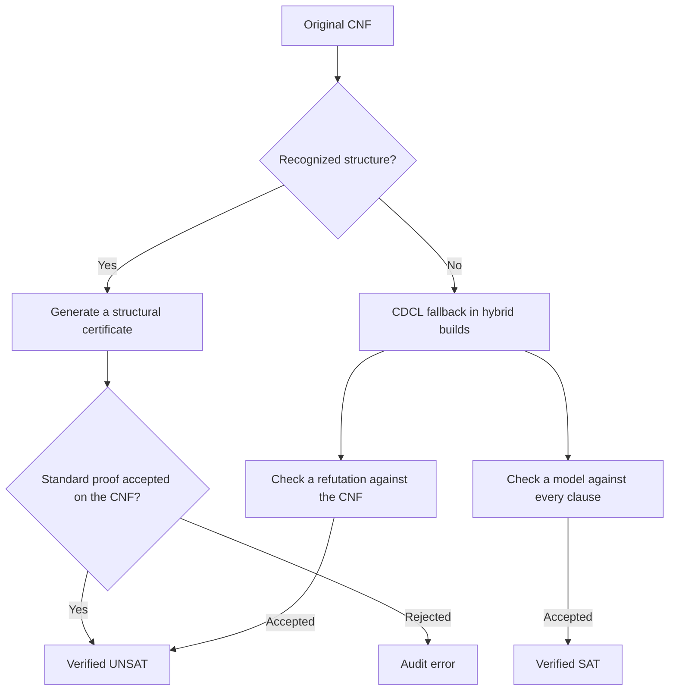

# DRNAS SAT

**Structural SAT solving and independently checkable proofs** · Frane Drnas, Croatia

Can a solver explain why a schedule is impossible before it tries every assignment? DRNAS SAT looks for mathematical structure in a Boolean formula and turns it into a proof that a separate program can check. This repository contains the C++ solvers, the proof generators, the original inputs for selected cases, and experiments that show where the approach succeeds or runs out of time.

[Hrvatski uvod](docs/UVOD_HR.md) · [Verify a proof](#verify-a-proof) · [Experimental results](#experimental-results) · [Source audit](docs/SOURCE_AUDIT.md)

## A schedule that cannot fit


In the m14 benchmark, each selected group requires an assignment. Eleven groups carry proof weight 2 and nine carry weight 1. Their demand is **11 × 2 + 9 × 1 = 31**. The original clauses describing the 14 machines imply a combined capacity of **30** in the same units. Every feasible assignment would have to satisfy both bounds. The contradiction rules out every schedule allowed by this formula. [Original CNF, weights and proof](evidence/pcmax-weighted2/05)

Akram and Schreiber reported m14 as UNSAT in 2024. The contribution documented here is a structural derivation from the original CNF and a 557,597-byte certificate that anyone can replay. The same method produced accepted proofs on **11 of 20** retrospective PCMAX formulas. It returned **UNKNOWN on all nine SAT-labeled controls**. [Original benchmark paper, Table I](https://dominikschreiber.de/papers/2024-isc-pcmax.pdf) · [All 20 outcomes](evidence/pcmax-weighted2/summary.json) · [Proof registry](docs/VERIFIED_PROOF_REGISTRY.md)

## Why the graph encoding matters


The picture is a teaching example. In an actual benchmark, the code has to find the clique and identify the clauses that forbid adjacent vertices from sharing each color. On input 55 it found **11 mutually adjacent vertices with only 10 colors**. Its 5,841-byte certificate can be checked directly against all 14,440 clauses of the input. [Original CNF and K₁₁ proof](evidence/graph-k11) · [Graph proof generator](research/graphclique/emit_veripb.py)

| Test | What changed | Verified outcome |
|---|---|---|
| Fixed-graph coloring, eight SAT Competition 2026 originals | Edges are constraints in the input. For each clique, the generator identifies the relevant same-color exclusions. | **8/8** original CNFs proved UNSAT. Two had an unknown catalog label. [Eight source records](evidence/ci/fixed-graph8.json) |
| First test on ten SAT Competition 2025 originals | The graph's edges are themselves variables. The fixed-graph method had no matching witness. | **0/20** verified attempts per arm, including reference solvers, at an 8 s cap. [First test](evidence/ci/graph-first10.json) |
| Replay of those same ten after development | The new proof relates clique positions, selected edges and vertex colors through the original clauses. | **20/20** externally verified UNSAT attempts on **10 distinct CNFs**. This measures coverage after inspecting the encoding. [Replay](evidence/ci/clique-color-replay10.json) |
| Ten further originals from seven other catalog families | Family-disjoint test of transfer, with two repetitions and the same 8 s cap. | **0/20** strict verified attempts for each of seven arms. [Holdout](evidence/ci/graph-disjoint10.json) |

## Experimental results

A **source** is one input formula. An **attempt** is one method on one source in one repetition. Independent checkers validate SAT models against input clauses and UNSAT certificates against the named proof system. Rows keep their own datasets and counting units.

| Experiment | Observation | Evidence and scope |
|---|---|---|
| Graph + MATH5 on real67 | 22/134 strict verified attempts on 11/67 sources. The 22 comprise 16 graph proofs, four MATH5 proofs and two models. | Retrospective, two repeats. The family-bootstrap interval for savings versus Kissat crosses zero. [Paired results](evidence/ci/graph-real67.json) |
| XOR234 on Tseitin grids | GF(2) parity leads to contradiction on both grid inputs. VeriPB accepted 4/4 attempts, two per source. | Two development cases with XOR rows of widths 2–4. [Grid proof](evidence/xor234-grid5) · [All arms](evidence/ci/xor234-grid2.json) |
| IPG7-B on weighted Petersen | The 45-variable, 300-clause original has six full-load configurations. A 150-step cutting-planes proof closes the original CNF. | Bounded case splitting generates the source lemmas. The seven-step proof in the earlier study targets a derived master. [Original and proof](evidence/ipg7b-petersen) · [Method](research/IPG7B_DIRECT_ORIGINAL_VERIPB_RESULTS.md) |
| Matching and Hall cuts | MATCH3 found 18 restricted Hall witnesses on generated CNFs. MATCH4 checked six variants of the same Petersen problem, two SAT controls, and returned two UNKNOWNs. | Project-specific checkers. The variants test robustness under transformation. [MATCH3 run](https://github.com/Frane12/AndroidGameTest/actions/runs/43862296099) · [MATCH4 results](evidence/ci/match4.json) |
| MATH4 on 15 held-out originals | 4/15 sources solved under the structural checker, 8/30 accepted attempts. Its strict DRAT column records 0/30. | A source-specific XOR certificate and a standard proof are scored separately. [Both scores](evidence/ci/math4-unseen15.json) |
| TSP-SAT3 optimal tours | On five seeded problems of 5–9 cities, the X59 one-tree arm cut decision queries **56 → 22**. Both X59 arms certified 8/10 attempts. Kissat with the bound and symmetry certified 10/10. | Two repeats on previously used seeds. Optimality requires a feasible tour and a checked proof that a cheaper tour is impossible. [Full audit](evidence/ci/tsp-sat3.json) |

## What happens on mixed formulas?


On 12 prospectively selected mixed formulas, the XOR guard and its identical guard-off baseline each solved **4/12** distinct sources. Kissat and CaDiCaL each solved **6/12**. The guard increased total strict PAR2 by **0.57 s**. Each solver had one logical CPU and two attempts per formula. A verified completion incurs its measured end-to-end time, including checking. An unsuccessful attempt incurs twice the 8 s cap. The graph plots sums over 24 attempts per arm. [Machine-readable totals](evidence/ci/xorlin-mixed12.json) · [Per-source analysis](research/XORLIN_CDCL1_PROSPECTIVE_MIXED12_FINAL.md)

## From formula to verdict



A standalone recognizer may return UNKNOWN. A hybrid can spend its remaining budget in CDCL, which learns clauses from conflicts. In the strict benchmark, timeouts, unsupported inputs and unchecked outputs earn no solve. A rejected proof is recorded as an error in the audit. [Proof policy and experiment map](docs/SOURCE_AUDIT.md)

## Verify a proof

From the repository root, with Rust/Cargo available, install the pinned external checker and replay the m14 case.

```sh
cargo install veripb --version 3.0.2 --locked
veripb --cnf evidence/pcmax-weighted2/05/original.cnf evidence/pcmax-weighted2/05/weighted.pbp
```

The checker prints `s VERIFIED UNSATISFIABLE`. To validate all **14 bundled CNF/proof pairs**, including the graph, grid and Petersen examples, use Python 3. The script checks the SHA-256 of both files before calling VeriPB.

```sh
python3 scripts/replay_certificates.py
```

[Verifier and proof format](https://veripb.org/) · [Proof hashes](evidence/structural-replay.json) · [PCMAX proof hashes](evidence/pcmax-weighted2/verified_manifest.json)

## Explore the repository

| To investigate | Start here |
|---|---|
| Native CDCL, BDD capacity and fallback | [C++ source](src) · [PCMAX method](research/pcmax_capacity/WEIGHTED_VERIPB2.md) · [Native integration](research/GRAND_UNIFIED_EVIDENCE.md) |
| Graph coloring, parity and optimization | [Clique vs coloring](research/clique_color_er) · [XOR proofs](research/math5) · [TSP one-tree bounds](research/tsp_sat3) |
| Adaptive search and its costs | [LTM memory](research/DRNAS_LTM8.md) · [X47 validation and abstention](docs/DRNAS_X47_RISKGATE_RESULTS_2026-11-13.md) · [COOP5 probe budget](docs/DRNAS_COOP5_PROBE_BUDGET.md) |
| Data, provenance and attribution | [CI results and archive hashes](evidence/ci/provenance.json) · [Migration and branch comparison](docs/SOURCE_AUDIT.md) · [Citation](CITATION.cff) |

Experiments originated in [Frane12/AndroidGameTest](https://github.com/Frane12/AndroidGameTest). When citing a result, include the experiment, source hash and repository revision. External solvers, proof systems and benchmark encodings are credited to their authors in the linked protocols.

**Research topics** · [#sat-solving](https://github.com/topics/sat-solving) · [#graph-coloring](https://github.com/topics/graph-coloring) · [#scheduling](https://github.com/topics/scheduling) · [#formal-verification](https://github.com/topics/formal-verification) · [#combinatorial-optimization](https://github.com/topics/combinatorial-optimization)
