# DRNAS SAT

**Structural SAT solving and independently checkable proofs** · Frane Drnas, Croatia

Can a solver explain why a schedule is impossible before it tries every assignment? DRNAS SAT looks for mathematical structure in a Boolean formula and turns it into a proof that a separate program can check. This repository contains the C++ solvers, the proof generators, the original inputs for selected cases, and experiments that show where the approach succeeds or runs out of time.

[Hrvatski uvod](docs/UVOD_HR.md) · [Fano experiment](#seven-jobs-in-triples) · [Illustrated formulas](#illustrated-formulas) · [Verify a proof](#verify-a-proof) · [Experimental results](#experimental-results) · [Source audit](docs/SOURCE_AUDIT.md)

## A schedule that cannot fit

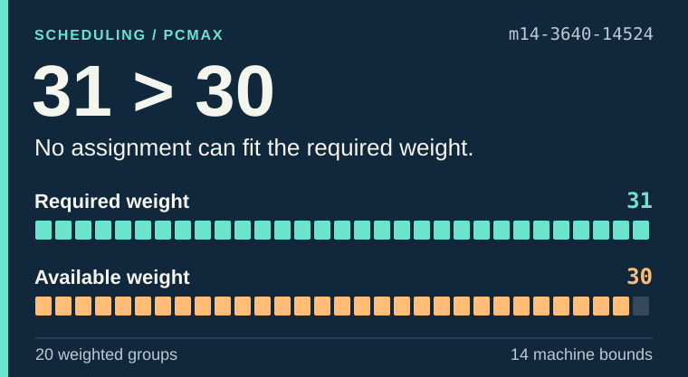

In the m14 benchmark, each selected group requires an assignment. Eleven groups carry proof weight 2 and nine carry weight 1. Their demand is **11 × 2 + 9 × 1 = 31**. The original clauses describing the 14 machines imply a combined capacity of **30** in the same units. Every feasible assignment would have to satisfy both bounds. The contradiction rules out every schedule allowed by this formula. [Original CNF, weights and proof](evidence/pcmax-weighted2/05)

Write $W$ for the proof weight of the selected assignments. The left bound comes from the job groups, and the right bound from the machines. A feasible schedule would require

$$31 = 11(2)+9(1)  \le W \le  2(0)+3(1)+6(2)+3(5) = 30.$$

Akram and Schreiber reported m14 as UNSAT in 2024. The contribution documented here is a structural derivation from the original CNF and a 557,597-byte certificate that anyone can replay. The same method produced accepted proofs on **11 of 20** retrospective PCMAX formulas. It returned **UNKNOWN on all nine SAT-labeled controls**. [Original benchmark paper, Table I](https://dominikschreiber.de/papers/2024-isc-pcmax.pdf) · [All 20 outcomes](evidence/pcmax-weighted2/summary.json) · [Proof registry](docs/VERIFIED_PROOF_REGISTRY.md)

## Seven jobs in triples

In the generated MATH-HYBRID3 experiment, seven jobs must each go to exactly one of three machines. A machine may sit idle or take one of the seven triples in the Fano plane. Each line in the diagram, including the circle, joins three jobs.

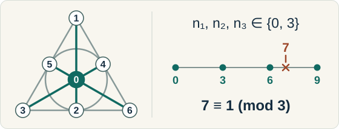

Imagine giving each machine one of the three highlighted triples. Job 0 would appear three times and every other job once. All seven counts are odd, so checking parity alone misses the repeated job. Counting in threes settles the question for **every** choice of triples. Each machine takes 0 or 3 jobs, so the total must be 0, 3, 6 or 9. It must also be exactly **7**. [Construction and derivation](https://github.com/Frane12/DRNAS-SAT/blob/aad2fb20f5f68bcfec42490dc928ae0a58db74fa/research/pcmax_hybrid3/THEOREM.md)

On 20 November 2026, VeriPB 3.0.2 accepted two reverse unit propagation (RUP) proofs for this same CNF with 135 variables and 253 clauses. The first took **3,280 proof steps**. Ending a branch as soon as one machine had no legal way to complete its load reduced the proof to **175 steps**. [Compact proof generator](https://github.com/Frane12/DRNAS-SAT/blob/aad2fb20f5f68bcfec42490dc928ae0a58db74fa/research/pcmax_hybrid3/emit_compact.py) · [Independent check of both proofs](https://github.com/Frane12/DRNAS-SAT/actions/runs/44699265702/job/136163392115)

<details>
<summary><strong>What changes with six jobs? A 31-step proof</strong></summary>

In a second generated experiment, MATH-HYBRID4, two machines must cover six jobs. Three jobs on each machine give the right total. But the two triples must also be disjoint. Each cell below counts the jobs shared by a pair of allowed triples. A valid schedule needs a zero. Every cell contains at least one.

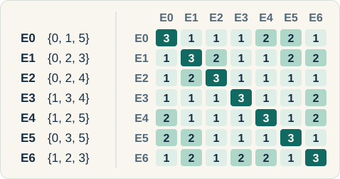

VeriPB accepted a **31-step RUP proof**. Adding the complement of one triple gave a SAT control with a model that satisfied all 146 control clauses. [Allowed triples and derivation](https://github.com/Frane12/DRNAS-SAT/blob/5784445ebce127f4010f7ae1283ec685451369c1/research/pcmax_hybrid4/THEOREM.md) · [Proof and control checks](https://github.com/Frane12/DRNAS-SAT/actions/runs/44701505078/job/136170741240)

</details>

## Why the graph encoding matters

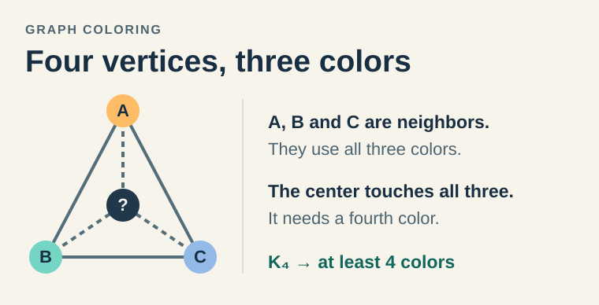

The picture is a teaching example. In an actual benchmark, the code has to find the clique and identify the clauses that forbid adjacent vertices from sharing each color. On input 55 it found **11 mutually adjacent vertices with only 10 colors**. Its 5,841-byte certificate can be checked directly against all 14,440 clauses of the input. [Original CNF and K₁₁ proof](evidence/graph-k11) · [Graph proof generator](research/graphclique/emit_veripb.py)

For a fixed graph $G$, a clique is a set of vertices that are all neighbors. Its size gives a lower bound on the number of colors needed. In input 55, the clique alone gives the contradiction

$$11 = |V(K_{11})|  \le  \chi(G)  \le  10.$$

### When the edges are variables

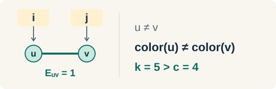

Here $P_{i,u}$ means position $i$ selects vertex $u$, $E_{uv}$ means the edge exists, and $C_{u,t}$ means vertex $u$ has color $t$. For distinct positions and distinct selected vertices, two input rules connect those choices.

$$P_{i,u}\land P_{j,v} \Rightarrow E_{uv}, \qquad E_{uv}\land C_{u,t} \Rightarrow \neg C_{v,t}.$$

On source 9, selecting five clique vertices forces all ten edges between them. Four colors cannot distinguish five mutually adjacent vertices. The extension proof makes these implications explicit in the original encoding. [Source 9 and the input clauses](research/CLIQUE_COLORING_2025_SOURCE_AUDIT.md)

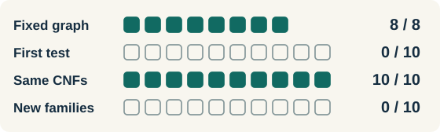

Each square is **one distinct CNF**. A filled square means at least one strict result was accepted for that source in the indicated test. An empty square means the test produced no strict result within its budget. The second and third rows use the same ten inputs. The table gives the attempt counts.

| Test | What changed | Verified outcome |
|---|---|---|
| Fixed-graph coloring, eight SAT Competition 2026 originals | Edges are constraints in the input. For each clique, the generator identifies the relevant same-color exclusions. | **8/8** original CNFs proved UNSAT. Two had an unknown catalog label. [Eight source records](evidence/ci/fixed-graph8.json) |
| First test on ten SAT Competition 2025 originals | The graph's edges are themselves variables. The fixed-graph method had no matching witness. | **0/20** verified attempts per arm, including reference solvers, at an 8 s cap. [First test](evidence/ci/graph-first10.json) |
| Replay of those same ten after development | The new proof relates clique positions, selected edges and vertex colors through the original clauses. | **20/20** externally verified UNSAT attempts on **10 distinct CNFs**. This measures coverage after inspecting the encoding. [Replay](evidence/ci/clique-color-replay10.json) |
| Ten further originals from seven other catalog families | Family-disjoint test of transfer, with two repetitions and the same 8 s cap. | **0/20** strict verified attempts for each of seven arms. [Holdout](evidence/ci/graph-disjoint10.json) |

## Experimental results

A **source** is one input formula. An **attempt** is one method on one source in one repetition. Independent checkers validate SAT models against input clauses and UNSAT certificates against the named proof system. Rows keep their own datasets and counting units.

| Experiment | Observation | Evidence and scope |
|---|---|---|
| Graph + MATH5 on real67 | 22/134 strict verified attempts on 11/67 sources. The 22 comprise 16 graph proofs, four MATH5 proofs and two models. | Retrospective, two repeats. The family-bootstrap interval for savings versus Kissat crosses zero. [Paired results](evidence/ci/graph-real67.json) |
| XOR234 on Tseitin grids | GF(2) parity leads to contradiction on both grid inputs. VeriPB accepted 4/4 attempts, two per source. | Two development cases with XOR rows of widths 2–4. [Grid proof](evidence/xor234-grid5) · [All arms](evidence/ci/xor234-grid2.json) |
| IPG7-B on weighted Petersen | The 45-variable, 300-clause original has six full-load configurations. A 150-step cutting-planes proof closes the original CNF. | Bounded case splitting generates the source lemmas. The seven-step proof in the earlier study targets a derived master. [Original and proof](evidence/ipg7b-petersen) · [Method](research/IPG7B_DIRECT_ORIGINAL_VERIPB_RESULTS.md) |
| Matching and Hall cuts | MATCH3 found 18 restricted Hall witnesses on generated CNFs. MATCH4 checked six variants of the same Petersen problem, two SAT controls, and returned two UNKNOWNs. | Project-specific checkers. The variants test robustness under transformation. [MATCH3 run](https://github.com/Frane12/AndroidGameTest/actions/runs/43862296099) · [MATCH4 results](evidence/ci/match4.json) |
| MATH4 on 15 held-out originals | 4/15 sources solved under the structural checker, 8/30 accepted attempts. Its strict DRAT column records 0/30. | A source-specific XOR certificate and a standard proof are scored separately. [Both scores](evidence/ci/math4-unseen15.json) |
| TSP-SAT3 optimal tours | On five seeded problems of 5–9 cities, the X59 one-tree arm cut decision queries **56 → 22**. Both X59 arms certified 8/10 attempts. Kissat with the bound and symmetry certified 10/10. | Two repeats on previously used seeds. Optimality requires a feasible tour and a checked proof that a cheaper tour is impossible. [Full audit](evidence/ci/tsp-sat3.json) |

## Illustrated formulas

Open an experiment to see its construction, the equation and the underlying evidence.

<details>
<summary><strong>Graph + MATH5 · what counted as a solve on real67</strong></summary>

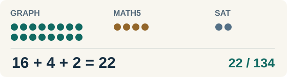

The two UNSAT routes contributed $16+4=20$ proofs. Two checked SAT models brought the total to $22/134$ attempts. The two repetitions covered **11 distinct solved formulas** out of 67. [Certificate counts](evidence/ci/graph-real67.json)

</details>

<details>
<summary><strong>XOR234 · why every edge cancels</strong></summary>

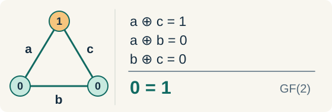

Each vertex says whether the number of incident edges set to 1 is odd or even. In the triangle, adding all three equations modulo two gives

$$(a\oplus c)\oplus(a\oplus b)\oplus(b\oplus c)=1\oplus0\oplus0.$$

The left side is 0 because each bit occurs twice. The right side is 1. The pictured triangle is a teaching example. The same cancellation on the original 12 × 12 grid uses **144 vertex equations and 264 edge variables**. [Grid derivation](research/MATH5_XOR234_GRID_VERIPB_RESULTS.md) · [Original and proof](evidence/xor234-grid5)

</details>

<details>
<summary><strong>Hall / MATCH3 · three jobs compete for two places</strong></summary>

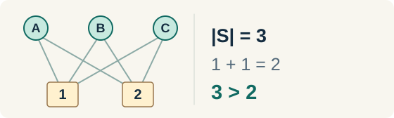

In this teaching example, $S$ is the set of three jobs, $N(S)$ is the set of resources they can use, and $c_r$ is the capacity of resource $r$. Every feasible assignment requires $|S|\le\sum_{r\in N(S)}c_r$. Here **$3\gt 1+1$**, so at least one job would be left without a place. MATCH3 checks the restrictions against the input clauses before using the cut. [Hall witness and checker](research/MATCH3_FLOW_HALL_POLY1.md)

</details>

<details>
<summary><strong>Weighted Petersen / IPG7-B · what the six configurations share</strong></summary>

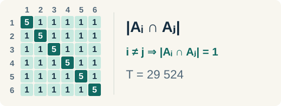

All jobs together weigh $3T$, with $T=29{,}524$ per machine. All three machines would have to fill exactly to $T$. Enumerating the 15 job weights in the original gives six possible full loads. Entry $(i,j)$ counts the jobs shared by two loads.

$$\mathcal F=\left\lbrace A:\sum_{j\in A}w_j=T\right\rbrace,\qquad |\mathcal F|=6,\qquad |A_i\cap A_j|=1\quad(i\ne j).$$

Even two full machines would have to share a job. Each job may be assigned only once. IPG7-B uses these configurations to guide bounded case splits in its 150-step original-CNF proof. [Original weights and proof](evidence/ipg7b-petersen) · [Proof construction](research/IPG7B_DIRECT_ORIGINAL_VERIPB_RESULTS.md)

</details>

<details>
<summary><strong>Petersen / MATCH4 · why two remaining edge colors cannot alternate</strong></summary>

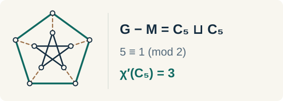

Here colors belong to **edges**. In a three-edge-coloring of a cubic graph, the edges of any one color form a perfect matching $M$. Remove the five dashed edges in the picture. The other two colors would have to alternate on each remaining cycle. A five-cycle returns to its starting vertex after an odd number of edges, so the first and last edges would have the same color. The checker finds an odd complementary cycle for **each of the six** possible matchings. [MATCH4 derivation and scope](research/MATCH4_SOURCE_WEIGHTED_PARITY.md)

</details>

<details>
<summary><strong>MATH4 · combining parity with values fixed by the CNF</strong></summary>

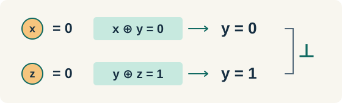

In this teaching example, $x=z=0$. The first parity equation forces $y=0$ and the second forces $y=1$. Equivalently, adding the equations gives $x\oplus z=1$, which the two fixed values contradict. On unseen15, three distinct Lights Out inputs yielded project-checked parity contradictions. A fourth source was solved by the Hall path. [Source-level results](research/math4/EVIDENCE_REAL24_UNSEEN15.md)

</details>

<details>
<summary><strong>TSP-SAT3 · proving that a five-city tour is shortest</strong></summary>

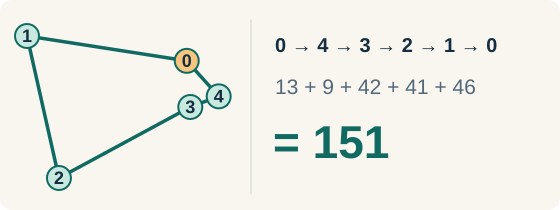

Each segment uses the benchmark’s rounded Euclidean distance. The drawn tour gives an upper bound of **151**. The DRAT proof for the decision CNF at **150** excludes every tour costing 150 or less. Because costs are integers, the bounds meet.

$$151\le L^*\le 13+9+42+41+46=151.$$

The one-tree lower bound also reached 151 on this case. The archived optimality audit required the standard SAT proof at 150. [Five-case results](evidence/ci/tsp-sat3.json) · [Historical run with the route and proof](https://github.com/Frane12/AndroidGameTest/actions/runs/43950106984)

</details>

## What happens on mixed formulas?

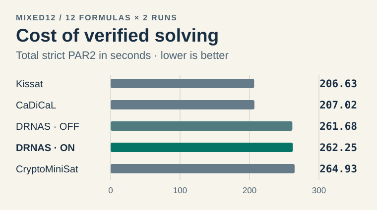

On 12 prospectively selected mixed formulas, the XOR guard and its identical guard-off baseline each solved **4/12** distinct sources. Kissat and CaDiCaL each solved **6/12**. The guard increased total strict PAR2 by **0.57 s**. Each solver had one logical CPU and two attempts per formula. A verified completion incurs its measured end-to-end time, including checking. An unsuccessful attempt incurs twice the 8 s cap. The graph plots sums over 24 attempts per arm. [Machine-readable totals](evidence/ci/xorlin-mixed12.json) · [Per-source analysis](research/XORLIN_CDCL1_PROSPECTIVE_MIXED12_FINAL.md)

For the mixed12 chart, let $V$ be the attempts verified within the cap and $t_i$ their end-to-end times. At $T=8$ s, each other attempt costs $2T=16$ s. For the guard-on arm the 16 unsuccessful attempts contribute 256 s all by themselves.

$$\mathrm{PAR2}_{\rm sum}=\sum_{i\in V} t_i+2T(24-|V|)=6.250680+16\cdot16=262.250680\ \mathrm{s}.$$

## From formula to verdict

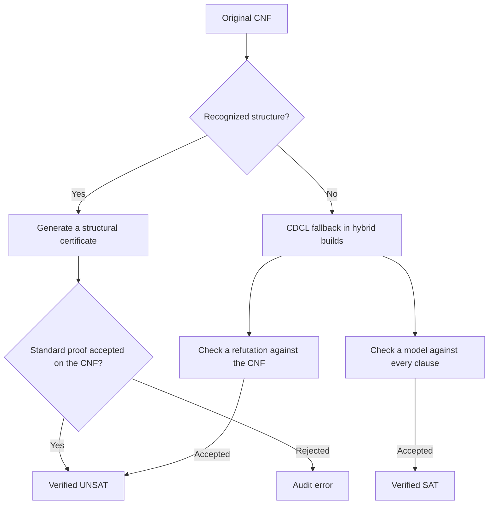

A standalone recognizer may return UNKNOWN. A hybrid can spend its remaining budget in CDCL, which learns clauses from conflicts. In the strict benchmark, timeouts, unsupported inputs and unchecked outputs earn no solve. A rejected proof is recorded as an error in the audit. [Proof policy and experiment map](docs/SOURCE_AUDIT.md)

## Verify a proof

From the repository root, with Rust/Cargo available, install the pinned external checker and replay the m14 case.

```sh
cargo install veripb --version 3.0.2 --locked
veripb --cnf evidence/pcmax-weighted2/05/original.cnf evidence/pcmax-weighted2/05/weighted.pbp
```

The checker prints `s VERIFIED UNSATISFIABLE`. To validate all **14 bundled CNF/proof pairs**, including the graph, grid and Petersen examples, use Python 3. The script checks the SHA-256 of both files before calling VeriPB.

```sh
python3 scripts/replay_certificates.py
```

[Verifier and proof format](https://veripb.org/) · [Proof hashes](evidence/structural-replay.json) · [PCMAX proof hashes](evidence/pcmax-weighted2/verified_manifest.json)

## Explore the repository

| To investigate | Start here |
|---|---|
| Native CDCL, BDD capacity and fallback | [C++ source](src) · [PCMAX method](research/pcmax_capacity/WEIGHTED_VERIPB2.md) · [Native integration](research/GRAND_UNIFIED_EVIDENCE.md) |
| Graph coloring, parity and optimization | [Clique vs coloring](research/clique_color_er) · [XOR proofs](research/math5) · [TSP one-tree bounds](research/tsp_sat3) |
| Adaptive search and its costs | [LTM memory](research/DRNAS_LTM8.md) · [X47 validation and abstention](docs/DRNAS_X47_RISKGATE_RESULTS_2026-11-13.md) · [COOP5 probe budget](docs/DRNAS_COOP5_PROBE_BUDGET.md) |
| Data, provenance and attribution | [CI results and archive hashes](evidence/ci/provenance.json) · [Migration and branch comparison](docs/SOURCE_AUDIT.md) · [Citation](CITATION.cff) |

Experiments originated in [Frane12/AndroidGameTest](https://github.com/Frane12/AndroidGameTest). When citing a result, include the experiment, source hash and repository revision. External solvers, proof systems and benchmark encodings are credited to their authors in the linked protocols.

**Research topics** · [#sat-solving](https://github.com/topics/sat-solving) · [#graph-coloring](https://github.com/topics/graph-coloring) · [#scheduling](https://github.com/topics/scheduling) · [#formal-verification](https://github.com/topics/formal-verification) · [#combinatorial-optimization](https://github.com/topics/combinatorial-optimization)
