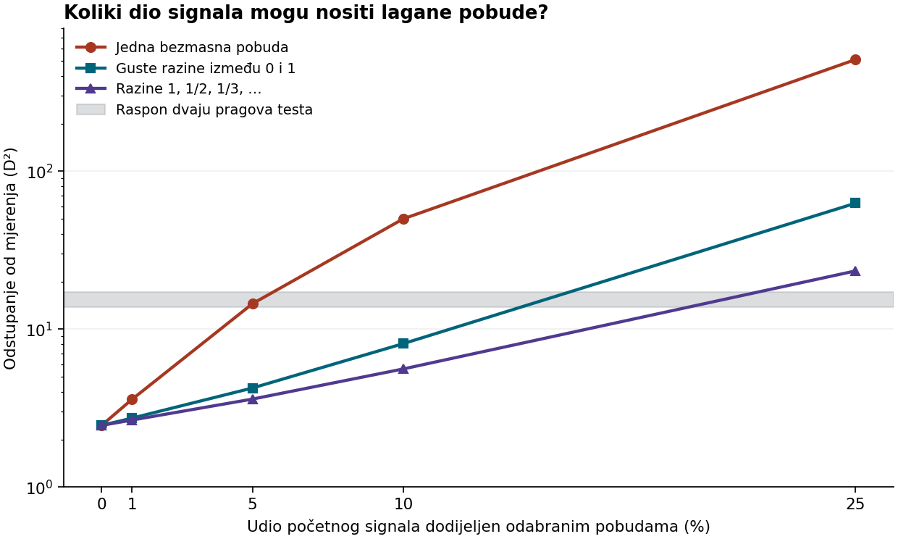

# YM39 · Mogu li se energije gomilati uz vakuum, a da ih mjerenje propusti?

Franeova ideja ima dvije provjerljive posljedice. Mjerenje može izgledati kao da ima najnižu pozitivnu energiju i kada u njemu postoji vrlo slab doprinos stanja uz vakuum. Za fizički protuprimjer trebalo bi u samoj teoriji naći takva stanja i pokazati da njihove energije prilaze vakuumu. Prva posljedica prolazi test na stvarnim podacima s rešetke. U ovim simulacijama nismo utvrdili drugu.

## Gdje se razine gomilaju?

Uzmimo vakuum energije 0. Ako su pobude k/N za k od 1 do N, prva energija je 1/N i ide prema 0. Ako su pobude 1+k/N, prva energija ide prema 1. Oba popisa s povećanjem N postaju jednako gusta. Dodavanje 17 svim energijama ostavlja svaki razmak jednakim. U Clayevu problemu treba ustanoviti postoji li jedan pozitivan razmak iznad vakuuma za cijeli fizički spektar.

## Isti podaci, različiti spektri

Ponovno smo analizirali podatke YM38 za tri prostorne veličine. Udio je dio početnog signala u jednoj pokretnoj skalarnoj petlji. D² mjeri odstupanje od svih pet vremenskih točaka zajedno, uz njihove međusobne korelacije. U glavnoj provjeri vrijednost do 13,84 je prihvatljiva. Svakom se volumenu dopuštaju vlastite pozitivne težine težih stanja. Model s pozitivnim pragom ima zadane mase od 0,8 naviše u jedinicama rešetke.

| Prostorna veličina | Samo pozitivni prag, D² | Uz 1 % bezmasne grane, D² | Uz 10 % niza masa 1/j, D² | Uz 10 % gusto raspoređenih masa od 0 do 1, D² |
|---|---:|---:|---:|---:|
| 4³ | 1,86 | 1,86 | 1,99 | 5,41 |
| 8³ | 3,42 | 3,46 | 3,52 | 3,59 |
| 16³ | 2,46 | 3,58 | 5,60 | 8,09 |

Skup gusto raspoređenih masa sadrži sve razlomke s neparnim brojnikom i nazivnikom 2ʲ između 0 i 1. Za svaki nazivnik dijelimo težinu 2⁻ʲ na njegove razlomke. U računu smo uključili j do 16. Ukupna izostavljena težina unutar te komponente iznosi najviše 1/65 536. U svakome od oba modela s beskonačno mnogo masa udio od 10 % pripada ukupnoj dodanoj seriji. Samo dio toga pripada njezinim najlakšim članovima. Udio cijele serije od 25 % ne prolazi na najvećoj kutiji ni uz blaži statistički prag. Obje hipoteze (samo pozitivni prag ili uz 1 % bezmasnog signala) prolaze i provjeru na neovisnim ranijim mjerenjima, bez ponovne prilagodbe težina.

Siva traka prikazuje raspon glavnog praga i dodatne provjere s korekcijom za konačan broj blokova. Ispod trake obje provjere prihvaćaju model kao spojiv s podacima. Iznad nje obje ga odbacuju na izabranoj mreži težih masa. Crte povezuju ispitane udjele.

Na najvećoj kutiji glavni izračun bez odabira mreže težih masa daje približnu gornju granicu od 4,1 % na dio signala s energijom do energije probne bezmasne grane pri najnižem nenultom impulsu. Samo prve tri vremenske točke daju granicu od 9,3 %. Drukčiji statistički blokovi daju od 3,7 % do 4,8 % uz pet točaka. U 400 umjetnih ponavljanja sa šumom iz podataka veliki umetnuti signal (25 %) odbacio je model samo s težim masama u svih 400 ponavljanja na najvećoj kutiji. Kod 1 % to se dogodilo u 9 od 400, a bez umetanja u 12 od 400. Te učestalosti opisuju ovaj postupak i ove podatke.

## Novi pokus u čistom SU(2)

Sedam različitih mjerenja, prostorne veličine 8³ i 16³, vremenska duljina 24 i dvije vrijednosti sprege. Svaku postavku simulirali smo od uređenog i slučajnog početka. Nakon nerazlučene prve serije za 16³ pri β=2,35 izveli smo neovisnu dulju seriju za tu postavku. Ukupno smo izmjerili 18 432 puna prolaza po rešetki u deset Markovljevih lanaca. Uzastopni prolazi mogu biti statistički povezani. Ponovno pokretanje radi unakrsnih korelacija nije uključeno kao novo mjerenje.

U tablici su procjene energije iz vremenskih razmaka 2 i 3 u jedinicama rešetke, sa statističkom standardnom pogreškom. Crtica znači da procjena nije prošla tražene provjere razlučivosti, dvaju vremenskih prozora i početnih uvjeta. Protokol navodi sve provjere. Usporedba različitih sprega nema kalibriranu zajedničku fizičku skalu.

| Mjerenje | 2,35 · 8³ | 2,35 · 16³ | 2,35 · 16³ dulja serija | 2,45 · 8³ | 2,45 · 16³ |
|---|---:|---:|---:|---:|---:|
| Mala petlja u gibanju | 1,35 ± 0,16 | — | — | — | 1,19 ± 0,13 |
| Velika petlja u gibanju | 1,25 ± 0,12 | — | 1,12 ± 0,06 | — | 1,11 ± 0,11 |
| Mala petlja u mirovanju | 1,04 ± 0,17 | — | 1,03 ± 0,13 | 1,29 ± 0,23 | — |
| Velika petlja u mirovanju | 0,96 ± 0,14 | — | 1,04 ± 0,12 | 1,13 ± 0,17 | — |
| Razlika orijentacija u gibanju | — | — | — | — | — |
| Razlika orijentacija u mirovanju | — | — | — | — | — |
| Tok oko cijele kutije | 0,66 ± 0,03 | — | — | — | — |

U konačnoj periodičnoj kutiji simetrija centra daje točan primjer slijepe točke. Promjena predznaka veza kroz presjek kutije ostavlja malu zatvorenu petlju nepromijenjenom. Petlja koja jednom obiđe kutiju mijenja predznak. Zato mala petlja iz simetričnog vakuuma ne pobuđuje stanja neparna pod tom simetrijom. Njihova energija zahtijeva zasebno mjerenje. Provjera na nasumičnoj konfiguraciji potvrdila je očekivano ponašanje mjerenih veličina. Kod toka je i nepotpuno uzorkovanje simetrijskih sektora moguć izvor pogreške.

Dodatno smo spojili rezultate dviju veličina pokretne petlje. Njihovu najbolju kombinaciju odabrali smo na jednom početnom uvjetu i provjerili na drugom, a zatim ih zamijenili. U točno rješivom kontrolnom primjeru ista procedura izdvaja slabiju pobudu. Sljedeća tablica prikazuje rezultat na odvojenom dijelu podataka uz blokiranje od 64 prolaza. Pogreške su uvjetne na odabranu kombinaciju.

| Kutija, β=2,35 | Učenje na uređenom početku, provjera na slučajnom | Učenje na slučajnom početku, provjera na uređenom |
|---|---:|---:|
| 8³ | nerazlučeno | 1,35 ± 0,16 |
| 16³ | 1,09 ± 0,16 | nerazlučeno |
| 16³ dulja serija | 1,07 ± 0,07 | 1,20 ± 0,11 |

Puna numerička provjera uključuje i scenarij s upola manjom brzinom širenja, alternativne spektre u mirovanju te drukčije veličine statističkih blokova. Pojedinačna pobuda ili konačni broj kutija ne mogu pokazati da postoji niz fizičkih energija koji ide prema nuli u beskonačnom prostoru i nakon uklanjanja mreže. Neovisni znatno veći računi za najlakše opaženo skalarno stanje čistog SU(2) daju pozitivnu masu i pri ekstrapolaciji prema kontinuumu.

## Podaci i ponavljanje

- [Blokovi svih novih mjerenja](measurement_blocks.zip)
- [Potpuni brojčani rezultati](results.json)
- [Metoda, početni uvjeti i naredbe](protocol.md)
- [Izvorni uzorci prvog mjerenja](../ym38)
- [Službena formulacija Clay Mathematics Institutea](https://www.claymath.org/wp-content/uploads/2022/06/yangmills.pdf)
- [Athenodorou i Teper, tablica 23](https://arxiv.org/pdf/2106.00364)

Iz direktorija core/ym39 naredba `python controls.py --json` ponovno računa rezultate iz arhiviranih blokova. `python plot.py results.json` crta graf uz Matplotlib.
