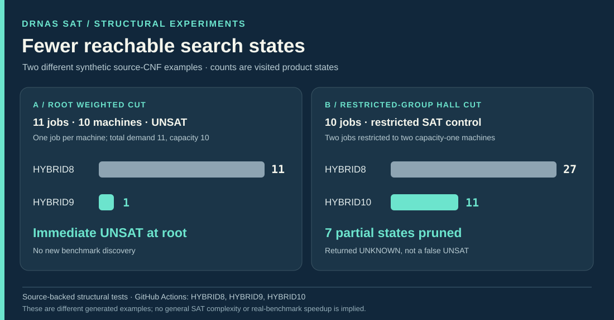
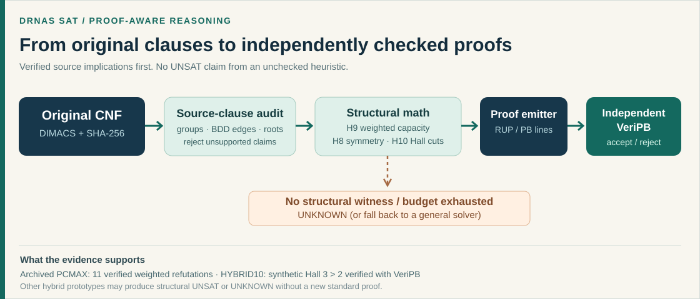

# DRNAS SAT — structural proof research update (20 November 2026)

**Scope and provenance.** This is an index to source-backed experiments, formal proofs and GitHub Actions evidence. Research variants remain on named **experimental branches**. A successful CI run is not automatically a standard proof; only an independently accepted proof against the specified original source CNF warrants an external VERIFIED UNSAT verdict. Nothing here establishes P=NP, P=coNP, or polynomial-time solving of arbitrary CNF formulas.

[English README](../README.md) · [Hrvatski uvod](UVOD_HR.md) · [PCMAX archive](../evidence/pcmax-weighted2) · [Source audit](SOURCE_AUDIT.md)

## Evidence by input family

| Dataset or experiment | Checked result | Important qualification |
|---|---|---|
| **Original PCMAX archive** (20 previously classified formulas) | VeriPB-accepted proofs for **11 original UNSAT CNFs**; structural detector returned UNKNOWN on all 9 SAT-labelled controls. | Previously published UNSAT classifications; newly documented source-derived proof route. [Summary](../evidence/pcmax-weighted2/summary.json) |
| **HYBRID6 symbolic product**, synthetic 9-job three-machine example | 100 product states; **401 RUP steps**, independently VeriPB-accepted. | Generated synthetic CNF. [Run](https://github.com/Frane12/DRNAS-SAT/actions/runs/44706409863) |
| **HYBRID6 Fano**, synthetic 7-job example | 58 product states; **233 RUP steps**, independently VeriPB-accepted. | Different compiler from an earlier 175-step compact Fano proof. [Run](https://github.com/Frane12/DRNAS-SAT/actions/runs/44706409863) |
| **HYBRID7** sparse eligibility / auxiliary selectors | **11/11 archived original CNFs were structurally accepted; 0/11 new product solves** within 1,000 states. | All were UNKNOWN_RESOURCE_LIMIT; the earlier verified weighted proofs remained valid. [Run](https://github.com/Frane12/DRNAS-SAT/actions/runs/44708615859) |
| **HYBRID8** symmetry quotient | Generated 10-machine 11-job UNSAT: **11 states**, compared with unquotiented solver exceeding **500**. | Structural outcome, not a new standard proof. Six original PCMAX inputs still hit the 3,000-state cap. [Run](https://github.com/Frane12/DRNAS-SAT/actions/runs/44709857869) |
| **HYBRID9** weighted root capacity + symmetry | All **11 already-proven** original PCMAX CNFs had independently recomputed capacity gaps and were discarded at **one state**. | **Regression/integration**, not a new UNSAT result or benchmark speed comparison. [Run](https://github.com/Frane12/DRNAS-SAT/actions/runs/44711793978) |
| **HYBRID10** restricted-group Hall cut | In a generated 10-job 10-machine input, global demand and global capacity both equal 10, yet the restricted three jobs require 3 and have capacity 2. Independent VeriPB accepted a **5,742-byte proof** on the unchanged generated **272-variable, 662-clause** CNF. | New proof for a **synthetic** formula, not a novel solution to an original competition instance. [Run](https://github.com/Frane12/DRNAS-SAT/actions/runs/44713058817) |
| **HYBRID10 SAT-possible control** | Symmetry-only product: **27** visited states; Hall-enhanced product: **11** states, with **7** pruned branches. | Both return UNKNOWN, not a false UNSAT. Different input from the HYBRID8/9 state comparison. [Same run](https://github.com/Frane12/DRNAS-SAT/actions/runs/44713058817) |

The two diagram panels are **different generated source CNFs**. They are not a performance comparison on real PCMAX benchmarks, and numbers of states are not runtimes.

## Proof-aware architecture

For selected groups G with positive proof weights lambda_g, the standard source-capacity criterion is:

\[
D=\sum_{g\in G}\lambda_g>\sum_j C_j \quad\Longrightarrow\quad \mathrm{UNSAT}.
\]

The HYBRID10 restricted-subset variant considers any selected set S of still-required groups at a product state q:

\[
D_i(S)=\sum_{\substack{g\in S\\g\text{ not yet assigned}}}\lambda_g>
\sum_j U_j(q,i,S)
\quad\Longrightarrow\quad\text{no satisfying extension of }q.
\]

Each local upper capacity U_j must be **soundly derived from the source-backed BDD**, including optimistic handling of skipped selectors. A structural UNKNOWN is not equivalent to SAT. A structural UNSAT result must be separately compiled and accepted by a standard verifier before it is described as an externally VERIFIED proof.

## Development milestones and limitations

| Experiment | What was implemented | Status and remaining limitation |
|---|---|---|
| [HYBRID5](https://github.com/Frane12/DRNAS-SAT/blob/experiment/pcmax-hybrid5-global3-20261120/research/pcmax_hybrid5/THEOREM.md) | Three-machine global exact-cover incompatibility | 301-step RUP source proof on a generated instance; prefix branching can expand. |
| [HYBRID6](https://github.com/Frane12/DRNAS-SAT/blob/experiment/pcmax-hybrid6-symbolic-product-20261120/research/pcmax_hybrid6/THEOREM.md) | Symbolic synchronous BDD product and product-state RUP proof compiler | BDD size and machine-product size may still grow exponentially. |
| [HYBRID7](https://github.com/Frane12/DRNAS-SAT/blob/experiment/pcmax-hybrid7-sparse-original-20261120/research/pcmax_hybrid7/THEOREM.md) | Sparse group-to-machine mapping and existential auxiliary-selector projection | Archived 11 original PCMAX inputs exceeded cap for new product. |
| [HYBRID8](https://github.com/Frane12/DRNAS-SAT/blob/experiment/pcmax-hybrid8-symmetry-20261120/research/pcmax_hybrid8/THEOREM.md) | Multiset quotient for isomorphic local machine BDDs | 0/6 new solves in an original-PCMAX retrospective six-case test under 3,000-state cap. |
| [HYBRID9](https://github.com/Frane12/DRNAS-SAT/blob/experiment/pcmax-hybrid9-weighted-cuts-20261120/research/pcmax_hybrid9/THEOREM.md) | Weighted root and conditional capacity bounds inside symmetry product | On archived originals, old weighted root certificates already separated, so no new coverage shown. |
| [HYBRID10](https://github.com/Frane12/DRNAS-SAT/blob/experiment/pcmax-hybrid10-hall-20261120/research/pcmax_hybrid10/THEOREM.md) | Hall-like subset capacity inequalities and external proof on a generated example | General dynamic product-state Hall cut-to-VeriPB compiler and prospective real holdout remain open. |

## Reproduction and scientific limits

The m14 original PCMAX refutation can be independently replayed after installing VeriPB 3.0.2:

    cargo install veripb --version 3.0.2 --locked
    veripb --cnf evidence/pcmax-weighted2/05/original.cnf evidence/pcmax-weighted2/05/weighted.pbp

Expected accepted result: **s VERIFIED UNSATISFIABLE**. The HYBRID10 [GitHub run and archived artifact](https://github.com/Frane12/DRNAS-SAT/actions/runs/44713058817) contain the generated Hall CNF, its source-bound witness, a proof file and the VeriPB log.

**Next experiment:** freeze the detector, select unseen family-disjoint original CNFs, record all UNKNOWNs as failures under strict benchmark scoring, and compare matched one-core wall/CPU time, memory and external checking against Kissat and CaDiCaL. Do not compare synthetic proof lengths against unrelated original-source benchmark times.

Akram and Schreiber are credited for the published PCMAX benchmark encodings and status classifications; BDDs, cutting planes, RUP, VeriPB and the reference solvers are established prior work. The DRNAS source analysis, implementations and experiment evidence belong to the linked versioned research branches.
