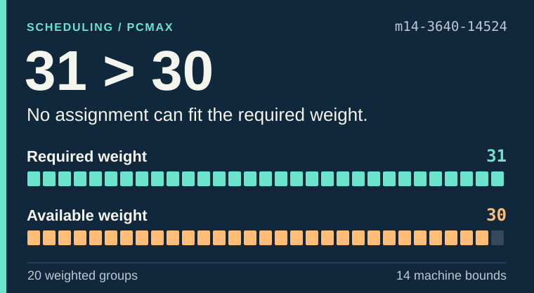
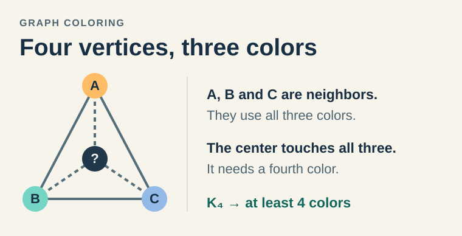

# DRNAS SAT · hrvatski uvod

Može li se svaki posao dodijeliti jednom od strojeva tako da svi završe do petka? Takvo se pitanje može zapisati nizom uvjeta. Primjerice, posao mora dobiti stroj, a svaki stroj ima granicu opterećenja. Kada uvjete zapišemo kao Booleovu formulu, SAT solver traži raspored koji zadovoljava sve uvjete. Jedan valjan raspored dovoljan je za odgovor **SAT**. Za **UNSAT** treba obrazložiti zašto svaki mogući raspored krši barem jedan uvjet.

DRNAS SAT istražuje kada iz same strukture formule možemo izvesti takav dokaz. Istraživanje vodi Frane Drnas. [Naslovnica na engleskom](../README.md) · [Izvorni kod](../src) · [Pregled izvora i eksperimenata](SOURCE_AUDIT.md)

## Kako se 31 i 30 pojave iz stvarne formule?



U primjeru **PCMAX m14** program je pronašao 20 skupina koje trebaju dodjelu. Za izvođenje dokaza jedanaest skupina dobije težinu 2, a devet težinu 1. Svaka dopuštena dodjela stoga zahtijeva najmanje **31 jedinicu dokazne težine**. Iz klauzula za 14 strojeva izvedu se gornje granice **0, 0, 1, 1, 1, 2, 2, 2, 2, 2, 2, 5, 5, 5**. Zbroj je **30**. Brojevi mjere težinu iz dokaza. Isti raspored morao bi ostvariti barem 31 i najviše 30, što je nemoguće. [Izvorni podaci i certifikat](../evidence/pcmax-weighted2/05)

Akram i Schreiber objavili su ishod m14 još 2024. Ovdje se može proučiti drukčiji put do njega, sve do pojedinih klauzula i formalnog certifikata od 557.597 bajtova. Na 20 već proučavanih PCMAX formula VeriPB je prihvatio 11 dokaza. Preostalih devet bile su kontrole označene kao SAT. Strukturni modul na svih je devet vratio UNKNOWN. [Tablica I izvornog rada](https://dominikschreiber.de/papers/2024-isc-pcmax.pdf) · [Registar svih 11 dokaza](VERIFIED_PROOF_REGISTRY.md)

## Što smo naučili iz bojanja grafova?



Zamisli da na karti svaki susjed mora imati različitu boju. Za trokut trebaju tri boje. Dodaj četvrti vrh spojen sa sva tri. Koju god od te tri boje odabereš, jedan je susjed već ima. U stvarnoj formuli iz primjera **K₁₁** solver je pronašao 11 međusobno povezanih vrhova uz samo deset dopuštenih boja. Neovisni provjerivač može pročitati izvornu formulu i dokaz od 5.841 bajta. [Formula i dokaz za K₁₁](../evidence/graph-k11)

| Pokus | Što pokazuju podaci |
|---|---|
| Osam originala sa zadanim grafom | Dokaz za svih osam. Dva su u katalogu imala nepoznat ishod. [Podaci](../evidence/ci/fixed-graph8.json) |
| Deset novih formula u kojima su i bridovi nepoznanice | Prvi postupak i referentni solveri imali su po 0/20 verificiranih pokušaja unutar osam sekundi. [Prvi pokus](../evidence/ci/graph-first10.json) |
| Ponovljeni pokus na istih deset | Nakon analize kodiranja, novi je postupak dao 20/20 prihvaćenih dokaza u dva ponavljanja. [Ponovljeni pokus](../evidence/ci/clique-color-replay10.json) |
| Deset formula iz sedam drugih obitelji | Svih sedam metoda završilo je s 0/20 prema strogom kriteriju. Taj pokus ograničava koliko široko možemo primijeniti prethodni rezultat. [Odvojeni skup](../evidence/ci/graph-disjoint10.json) |

## Ostali eksperimenti

| Područje | Rezultat i značenje |
|---|---|
| XOR i paritet | Na dvije odabrane Tseitinove mreže zbrajanjem jednadžbi po modulu 2 dobiva se proturječje. Sva četiri pokušaja praćena su prihvaćenim standardnim dokazom. [Rezultati](../evidence/ci/xor234-grid2.json) |
| Petersen i raspoređivanje | Za izvor od 45 varijabli i 300 klauzula postoji provjerljiv dokaz od 150 koraka. Pri njegovoj izradi korišteno je i ograničeno grananje. [Formula i dokaz](../evidence/ipg7b-petersen) |
| Trgovački putnik | Na pet malih problema granica dobivena 1-stablom smanjila je broj SAT upita s 56 na 22. Obje inačice X59 certificirale su optimum u 8/10 pokušaja. [Mjerenje](../evidence/ci/tsp-sat3.json) |
| Solver na mješovitim formulama | S uključenom i isključenom provjerom XOR-a DRNAS je riješio 4/12 različitih formula. Kissat i CaDiCaL riješili su po 6/12. [Usporedba](../evidence/ci/xorlin-mixed12.json) |

## Sam provjeri dokaz

Iz glavnog direktorija repozitorija pokreni sljedeće naredbe. Za instalaciju treba Rustov Cargo, a za skupnu provjeru Python 3.

```sh
cargo install veripb --version 3.0.2 --locked
veripb --cnf evidence/graph-k11/original.cnf evidence/graph-k11/proof.pbp
python3 scripts/replay_certificates.py
```

Prva provjera grafa ispisuje `s VERIFIED UNSATISFIABLE`. Zadnja naredba provjerava SHA-256 ulaza i dokaza za svih 14 priloženih parova te za svaki poziva VeriPB. [Program za provjeru](../scripts/replay_certificates.py)
