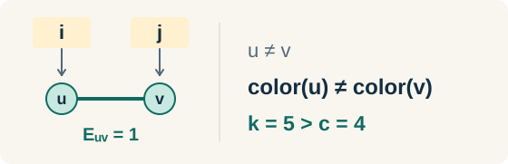
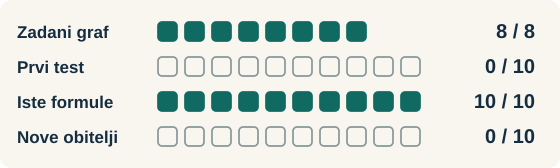
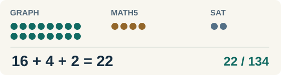
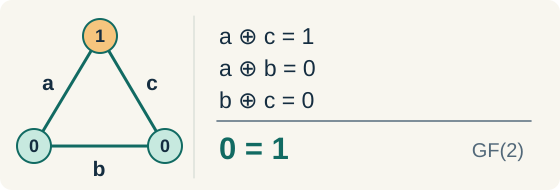
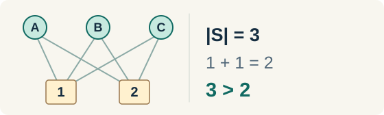
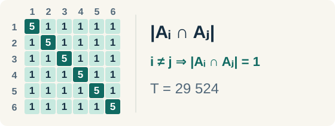
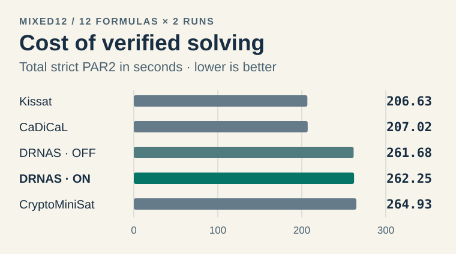

# DRNAS SAT · hrvatski uvod

Može li se svaki posao dodijeliti jednom od strojeva tako da svi završe do petka? Takvo se pitanje može zapisati nizom uvjeta. Primjerice, posao mora dobiti stroj, a svaki stroj ima granicu opterećenja. Kada uvjete zapišemo kao Booleovu formulu, SAT solver traži raspored koji zadovoljava sve uvjete. Jedan valjan raspored dovoljan je za odgovor **SAT**. Za **UNSAT** treba obrazložiti zašto svaki mogući raspored krši barem jedan uvjet.

DRNAS SAT istražuje kada iz same strukture formule možemo izvesti takav dokaz. Istraživanje vodi Frane Drnas. [Naslovnica na engleskom](../README.md) · [Slikovite formule](#slikovite-formule) · [Izvorni kod](../src) · [Pregled izvora i eksperimenata](SOURCE_AUDIT.md)

## Kako se 31 i 30 pojave iz stvarne formule?


U primjeru **PCMAX m14** program je pronašao 20 skupina koje trebaju dodjelu. Za izvođenje dokaza jedanaest skupina dobije težinu 2, a devet težinu 1. Svaka dopuštena dodjela stoga zahtijeva najmanje **31 jedinicu dokazne težine**. Iz klauzula za 14 strojeva izvedu se gornje granice **0, 0, 1, 1, 1, 2, 2, 2, 2, 2, 2, 5, 5, 5**. Zbroj je **30**. Brojevi mjere težinu iz dokaza. Isti raspored morao bi ostvariti barem 31 i najviše 30, što je nemoguće. [Izvorni podaci i certifikat](../evidence/pcmax-weighted2/05)

Označimo s $W$ ukupnu dokaznu težinu dodijeljenih poslova iz odabranih skupina. Lijevu granicu daju skupine poslova, a desnu strojevi. Svaki valjan raspored morao bi zadovoljiti

$$31 = 11(2)+9(1) \;\le W \le\; 2(0)+3(1)+6(2)+3(5) = 30.$$

Akram i Schreiber objavili su ishod m14 još 2024. Ovdje se može proučiti drukčiji put do njega, sve do pojedinih klauzula i formalnog certifikata od 557.597 bajtova. Na 20 već proučavanih PCMAX formula VeriPB je prihvatio 11 dokaza. Preostalih devet bile su kontrole označene kao SAT. Strukturni modul na svih je devet vratio UNKNOWN. [Tablica I izvornog rada](https://dominikschreiber.de/papers/2024-isc-pcmax.pdf) · [Registar svih 11 dokaza](VERIFIED_PROOF_REGISTRY.md)

## Što smo naučili iz bojanja grafova?


Zamisli da na karti svaki susjed mora imati različitu boju. Za trokut trebaju tri boje. Dodaj četvrti vrh spojen sa sva tri. Koju god od te tri boje odabereš, jedan je susjed već ima. U stvarnoj formuli iz primjera **K₁₁** solver je pronašao 11 međusobno povezanih vrhova uz samo deset dopuštenih boja. Neovisni provjerivač može pročitati izvornu formulu i dokaz od 5.841 bajta. [Formula i dokaz za K₁₁](../evidence/graph-k11)

**Klika** je skup vrhova u kojemu je svaki par susjedan. Označimo s $\chi(G)$ najmanji broj boja kojima možemo obojiti vrhove grafa $G$. U stvarnom primjeru K₁₁ lijevu granicu daje pronađena klika, a desnu bi morao zadovoljiti graf obojen s deset boja.

$$11 = |V(K_{11})| \;\le\; \chi(G) \;\le\; 10.$$

### Kad su i bridovi nepoznanice



Ovdje $P_{i,u}$ znači da položaj $i$ bira vrh $u$, $E_{uv}$ da između vrhova postoji brid, a $C_{u,t}$ da vrh $u$ ima boju $t$. Za dva različita položaja i dva različita vrha vrijede dva pravila.

$$P_{i,u}\land P_{j,v}\;\Rightarrow\;E_{uv}, \qquad E_{uv}\land C_{u,t}\;\Rightarrow\;\neg C_{v,t}.$$

Ako odaberemo oba vrha, između njih mora postojati brid. Ako prvi ima boju $t$, drugi mora dobiti neku drugu. U izvornom primjeru 9 odabir pet vrhova prisiljava svih deset bridova među njima. Treba pet različitih boja, a formula dopušta četiri. [Primjer 9 i izvorne klauzule](../research/CLIQUE_COLORING_2025_SOURCE_AUDIT.md)



**Jedan kvadratić predstavlja jednu različitu formulu.** Ispunjeni kvadratić znači da je provjerivač prihvatio rezultat u tom pokusu. Prazni znači da u zadanom vremenu nije dobiven provjeren rezultat. Drugi i treći red koriste istih deset formula. Tablica ispod broji i ponovljene pokušaje.

| Pokus | Što pokazuju podaci |
|---|---|
| Osam originala sa zadanim grafom | Dokaz za svih osam. Dva su u katalogu imala nepoznat ishod. [Podaci](../evidence/ci/fixed-graph8.json) |
| Deset novih formula u kojima su i bridovi nepoznanice | Prvi postupak i referentni solveri imali su po 0/20 verificiranih pokušaja unutar osam sekundi. [Prvi pokus](../evidence/ci/graph-first10.json) |
| Ponovljeni pokus na istih deset | Nakon analize kodiranja, novi je postupak dao 20/20 prihvaćenih dokaza u dva ponavljanja. [Ponovljeni pokus](../evidence/ci/clique-color-replay10.json) |
| Deset formula iz sedam drugih obitelji | Svih sedam metoda završilo je s 0/20 prema strogom kriteriju. Taj pokus ograničava koliko široko možemo primijeniti prethodni rezultat. [Odvojeni skup](../evidence/ci/graph-disjoint10.json) |

## Ostali eksperimenti

| Područje | Rezultat i značenje |
|---|---|
| XOR i paritet | Na dvije odabrane Tseitinove mreže zbrajanjem jednadžbi po modulu 2 dobiva se proturječje. Sva četiri pokušaja praćena su prihvaćenim standardnim dokazom. [Rezultati](../evidence/ci/xor234-grid2.json) |
| Petersen i raspoređivanje | Za izvor od 45 varijabli i 300 klauzula postoji provjerljiv dokaz od 150 koraka. Pri njegovoj izradi korišteno je i ograničeno grananje. [Formula i dokaz](../evidence/ipg7b-petersen) |
| Trgovački putnik | Na pet malih problema granica dobivena 1-stablom smanjila je broj SAT upita s 56 na 22. Obje inačice X59 certificirale su optimum u 8/10 pokušaja. [Mjerenje](../evidence/ci/tsp-sat3.json) |
| Solver na mješovitim formulama | S uključenom i isključenom provjerom XOR-a DRNAS je riješio 4/12 različitih formula. Kissat i CaDiCaL riješili su po 6/12. [Usporedba](../evidence/ci/xorlin-mixed12.json) |

## Slikovite formule

Otvori primjer koji te zanima. Uz crtež je račun i poveznica na dokaz ili podatke iz pokusa.

<details>
<summary><strong>Graf + MATH5 · odakle dolazi 22/134</strong></summary>



Modul za grafove dao je 16 dokaza da je formula nemoguća, a MATH5 još četiri. U dva druga pokušaja solver je našao valjanu dodjelu. Ukupno je $16+4+2=22$ od 134 pokušaja prošlo provjeru. U dva ponavljanja to je **11 različitih riješenih formula** od 67. [Zapis po vrsti dokaza](../evidence/ci/graph-real67.json)

</details>

<details>
<summary><strong>XOR234 · zašto svaki brid nestane iz zbroja</strong></summary>



Broj uz vrh kaže mora li broj uključenih bridova oko njega biti neparan (1) ili paran (0). Znak $\oplus$ znači zbrajanje po modulu dva. Zbrojimo sva tri uvjeta s crteža.

$$(a\oplus c)\oplus(a\oplus b)\oplus(b\oplus c)=1\oplus0\oplus0.$$

Svaki je brid na dva vrha, pa se svako slovo na lijevoj strani pojavljuje dvaput i poništi. Lijevo ostane **0**, desno **1**. Trokut je mali nastavni primjer. Na izvornoj mreži 12 × 12 isti račun obuhvaća **144 vršne jednadžbe i 264 varijable bridova**. [Izvod za mrežu](../research/MATH5_XOR234_GRID_VERIPB_RESULTS.md) · [Izvorna formula i dokaz](../evidence/xor234-grid5)

</details>

<details>
<summary><strong>Hall / MATCH3 · tri posla dijele samo dva mjesta</strong></summary>



Na ovoj skici $S$ su tri posla, $N(S)$ su strojevi dostupni tim poslovima, a $c_r$ je broj mjesta na stroju $r$. Da bi raspored bio moguć, treba vrijediti $|S|\le\sum_{r\in N(S)}c_r$. Ovdje je **$3>1+1$**. Kako god rasporedimo prva dva posla, za treći ponestane mjesta. MATCH3 prvo u klauzulama provjerava kojim strojevima posao smije pristupiti i koliki im je kapacitet. [Hallov uvjet i postupak provjere](../research/MATCH3_FLOW_HALL_POLY1.md)

</details>

<details>
<summary><strong>Petersen / IPG7-B · koji se posao ponavlja?</strong></summary>



Ukupna težina svih poslova je $3T$, a svaki od tri stroja prima najviše $T=29\,524$. Zato bi **sva tri morala biti točno puna**. Izvornih 15 težina daju šest različitih skupova poslova koji mogu napuniti jedan stroj. Redak i stupac slike biraju dva takva skupa. Broj u polju kaže koliko im je poslova zajedničko.

$$\mathcal F=\left\{A:\sum_{j\in A}w_j=T\right\},\qquad |\mathcal F|=6,\qquad |A_i\cap A_j|=1\quad(i\ne j).$$

Odaberi bilo koje polje izvan dijagonale. Svuda je **1**. Dakle, koja god dva različita puna tereta izabereš, isti bi posao morao ići na oba stroja. Izvorna formula dopušta mu samo jedan. IPG7-B tim skupovima vodi ograničeno grananje pri izradi dokaza od 150 koraka. [Težine i izvorni dokaz](../evidence/ipg7b-petersen) · [Kako je dokaz izgrađen](../research/IPG7B_DIRECT_ORIGINAL_VERIPB_RESULTS.md)

</details>

<details>
<summary><strong>Petersen / MATCH4 · zašto dvije boje zapnu na petom bridu</strong></summary>


Ovdje bojimo **bridove**. Ako graf s po tri brida na svakom vrhu ima valjano bojanje s tri boje, bridovi jedne boje tvore savršeno sparivanje $M$: svaki vrh dodiruju točno jednom. Na crtežu ih označavaju isprekidane crte. Kad ih uklonimo, ostanu dva ciklusa duljine pet. Pokušaj obojiti preostale bridove naizmjence crveno i plavo. Peti i prvi brid susreću se na istom vrhu i oba ispadaju crvena. Provjerivač nalazi neparan ciklus za **svako od šest mogućih sparivanja**. [Postupak MATCH4 i njegov provjerivač](../research/MATCH4_SOURCE_WEIGHTED_PARITY.md)

</details>

<details>
<summary><strong>MATH4 · kad ista varijabla mora biti i 0 i 1</strong></summary>


U nastavnom primjeru dvije jedinične klauzule zadaju $x=z=0$. Prvi red crteža daje $y=0$, a drugi $y=1$. Zbrajanjem jednadžbi dobivamo i kraći put do istog proturječja: $x\oplus z=1$, a već znamo da su obje vrijednosti nula. Na skupu unseen15 tri različite formule iz obitelji Lights Out dale su paritetne dokaze koje je prihvatio projektni provjerivač. Četvrta formula riješena je Hallovim postupkom. [Rezultati po obitelji i vrsti provjere](../research/math4/EVIDENCE_REAL24_UNSEEN15.md)

</details>

<details>
<summary><strong>TSP-SAT3 · kako znamo da je 151 najkraća ruta?</strong></summary>


Svaka dionica nosi euklidsku udaljenost zaokruženu prema pravilima pokusa. Nacrtana ruta ima duljinu **151**, pa optimalna ruta može biti najviše toliko duga. Neovisni provjerivač prihvatio je DRAT dokaz da ruta duljine **150 ili manje** nije moguća. Kako su cijene cijeli brojevi, dvije se granice sastanu.

$$151\le L^*\le 13+9+42+41+46=151.$$

I donja granica iz 1-stabla za ovaj je primjer dosegla 151. Pri konačnoj provjeri optimuma pokus zahtijeva i standardni dokaz za granicu 150. [Rezultati za pet skupova gradova](../evidence/ci/tsp-sat3.json) · [Izvorna ruta i dokaz iz pokusa](https://github.com/Frane12/AndroidGameTest/actions/runs/43950106984)

</details>

### Kako pročitati usporedbu na mješovitim formulama?



Svaka metoda imala je 24 pokušaja. Uspješan pokušaj plaća svoje vrijeme do kraja provjere. Za svaki ostali upisuje se dvostruki limit od 8 sekundi, dakle 16 sekundi. Uz uključeni XOR modul DRNAS je imao osam uspješnih i 16 ostalih pokušaja. Označimo s $V$ skup uspješnih, s $t_i$ njihova vremena, a s $T$ limit.

$$\mathrm{PAR2}_{\rm zbroj}=\sum_{i\in V}t_i+2T(24-|V|)=6{,}250680+16\cdot16=262{,}250680\ \mathrm{s}.$$

Od ukupnog rezultata **256 sekundi** potječe iz kazni za 16 pokušaja. Tako se na istom grafu vidi i cijena neriješenih formula. [Svi rezultati za mixed12](../evidence/ci/xorlin-mixed12.json)

## Sam provjeri dokaz

Iz glavnog direktorija repozitorija pokreni sljedeće naredbe. Za instalaciju treba Rustov Cargo, a za skupnu provjeru Python 3.

```sh
cargo install veripb --version 3.0.2 --locked
veripb --cnf evidence/graph-k11/original.cnf evidence/graph-k11/proof.pbp
python3 scripts/replay_certificates.py
```

Prva provjera grafa ispisuje `s VERIFIED UNSATISFIABLE`. Zadnja naredba provjerava SHA-256 ulaza i dokaza za svih 14 priloženih parova te za svaki poziva VeriPB. [Program za provjeru](../scripts/replay_certificates.py)
